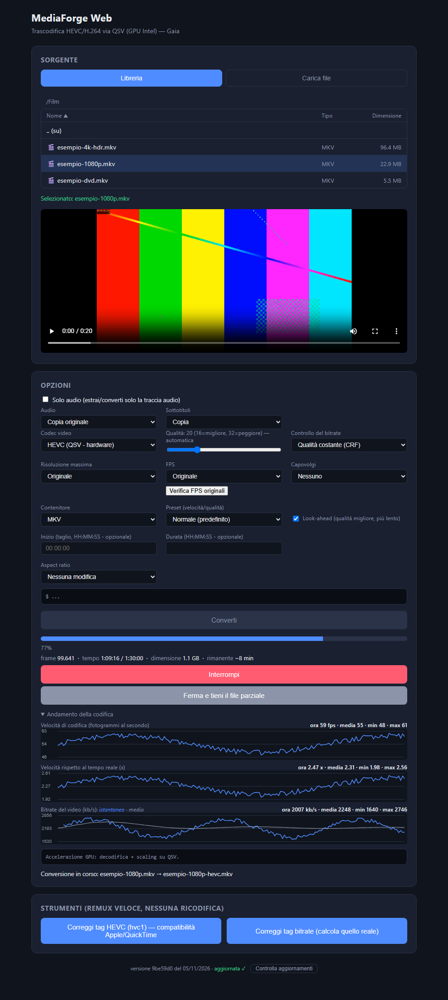

# MediaForge Web

Browser front end for the HEVC/H.264 transcoding of [MediaForge](https://github.com/milanone/MediaForge),
running in Docker on a home server. Pick a file from the library (or upload one), choose quality,
resolution, FPS, aspect ratio, audio and subtitles, and the server re-encodes it with ffmpeg,
using the Intel iGPU (QuickSync) when available. It is the sibling of the desktop app: same
encoding rules, different plumbing (files on the server, jobs in the background, download of the result).



*Screenshot generated from the running page with sample files and synthetic progress data (the QSV encoders are those of the author's server).*

## Features

- Source from a mounted library or upload; output to a mounted folder, plus download and in-browser playback
- Encoders probed at startup with a real 1-frame encode: `hevc_qsv`, `h264_qsv`, `libx265`
- QSV: hardware decoding and `scale_qsv` when the source allows it (codec/pixel-format gating), automatic
  retry in software if the GPU path fails or stalls; 3 real preset levels (fast / normal / slow)
- Default CRF follows the output resolution (480p=14, 720p=16, 1080p=18, 4K=20); a 4K source scaled down gets CRF 14
  (the detailed scenes lose most of their fine detail at higher values). Lowered by 2 on 2026-11-11: a 4K film kept at 4K
  came out at only 2700 kbps with CRF 22. Only the 4K points rest on real results; the lower resolutions follow the same shift
- "Prevedi bitrate": encodes a few short clips (default 3 of 1 minute; up to 20 clips, as short as 0.1 min; random or chosen
  times, with a button that draws a new set of random points) with the current settings and shows the bitrate of each,
  mean/min/max and the predicted video size; an estimate, not a promise. One run on a 4K series with 20 clips of 0.2 min gave
  2300 and 2400 kbps against about 2100 for the full encode: stable, but about 10-14% high
- "Copia originale" in the video codec menu: the video stream is copied as it is (no re-encode) and every video option is switched off; audio, subtitles, trim and container still apply
- **While a conversion runs the page shows only that conversion**: its parameters (source, output, codec, CRF or target
  bitrate, preset, resolution cap, audio, subtitles, trim, container), progress bar, live charts, log and the buttons to
  stop it. When it ends the card keeps the result and a "Nuova conversione" button brings the library and the options back
- Live charts while encoding: encoding speed (fps), speed against real time and the video bitrate (instantaneous over the last
  ~20 s, and average), with the elapsed time on the x axis. ffmpeg reports the bitrate of the whole file, so the audio is
  subtracted (a re-encoded track counts its new bitrate, e.g. AC-3 640 -> 384 counts 384; exact for constant-bitrate audio,
  an estimate for TrueHD/FLAC/DTS-HD). The first sample of each pass, taken while the encoder starts up, is not drawn
- After each encode: a chart of the exact video bitrate over time (from the packet sizes of the finished file; 30 s to 5 min steps,
  optional overlay of the source), a CSV download and the same values saved as `<output>_bitrate.csv` next to the file (comma-separated,
  one time column = the middle of each interval, in seconds: `time_s,kbps[,source_kbps]`); the page says where the CSV was saved
- "Bitrate nel tempo del file" (Strumenti card): the same chart and CSV for any file of the library, with no job needed, so it also
  works for encodes made before a restart of the server (the server forgets the finished jobs when it restarts)
- "Verifica FPS originali": counts the real (non-duplicated) frames on 5 short clips and sets the FPS accordingly. The same
  measurement runs by itself when a file is selected (the answer is cached per file). Repeats in a whole ratio (60 fps that are
  really 30, 50 that are 25) are flagged at once under the file information with a button that sets the FPS: dropping them is safe.
  Repeats at any other ratio (24 fps stored as 30) are only reported and the rate is left alone: removing them with the fps filter
  was seen to discard up to 25% of the real frames and repeat as many others (judder), while keeping them costs about 8% in size.
  Nothing is changed by itself
- The default output container is the source's own (mkv -> mkv, mp4/m4v/mov -> mp4; anything else -> mkv), changeable before converting
- Resolution cap, aspect ratio (crop / pad / DAR tag / stretch), flip, trim, audio re-encode or copy, subtitles
  (copy / SRT / none / mux afterwards), audio-only mode
- Rate control: constant quality (CRF) or a target average bitrate, with optional 2-pass for `libx265`
- "Ferma e tieni il file parziale": closes the running encode cleanly (ffmpeg `q`) and keeps a playable partial file
- Version in the footer ("aggiornata" / "nuova versione disponibile"), a "Controlla aggiornamenti" button and an
  "Aggiorna ora" button (needs the cron watcher below; otherwise the banner shows the manual command)
- Live numbers (frame, time, size, time remaining) next to the progress bar
- Background jobs that survive closing the page (reattach from any browser, with the same view and parameters)
- Maintenance remux (no re-encode): fix the `hvc1` tag, fix a stale bitrate tag

## Run

```bash
docker compose up -d --build     # http://<server>:5050
```

`docker-compose.yaml` is the one used on the author's server: adapt the library/output paths, the user and
the `render` group id (`group_add`) to your machine; `/dev/dri` must be passed through for QuickSync.
ffmpeg comes from the `jellyfin-ffmpeg7` package installed by the `Dockerfile`.

## Update

`./deploy.sh` in the project folder on the server pulls from GitHub and rebuilds the container (it refuses to run
while a conversion is in progress). To update automatically every night, run `auto-update.sh` from cron (`0 4 * * * /path/to/mediaforge-web/auto-update.sh`):
it deploys only when GitHub has a newer commit and nothing is being converted. For the in-page "Aggiorna ora" button, add to the server's crontab:

```
* * * * * /path/to/mediaforge-web/update-watcher.sh
```

The container has no access to Docker: the page only leaves a request file that this script picks up.

## Limits

- Only tested on an Intel N150 (QuickSync) with the Jellyfin ffmpeg build; AMD/NVIDIA are not supported here
- No authentication: expose it only on a trusted network
- Target bitrate, 2-pass and the clean stop were added on 2026-10-18 and tested with `libx265` on Windows only;
  not yet verified with QSV on the server
- "Prevedi bitrate" was tried with `hevc_qsv` on a Windows PC (local copy of the page) and with `libx265` in the
  tests; not yet on the server
- The running-conversion view, the live charts, the bitrate chart/CSV and the per-file chart were tried in a browser against a
  local copy of the server with `libx265` and synthetic clips, not yet on the server with QSV and a real film
- Finished jobs live in the server's memory: after a restart (every deploy) the page can no longer show the chart or the CSV link
  of a past conversion; use "Bitrate nel tempo del file" (the CSV saved next to the output is still there)
- The screenshot above predates the running-conversion view

## License

MIT, see `LICENSE`.
